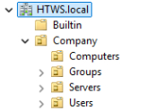
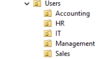

# Organizational Units

## Overview

Organizational Units (OUs) are used to organize objects
within Active Directory. They allow administrators to
manage users, computers, and groups through a structured
hierarchy.

This lab uses departmental OUs to simulate an enterprise
organizational structure.

## OU Structure

```text
HTWS.local
│
└── Company
    │
    ├── Computers
    │
    ├── Groups
    │   ├── Security
    │   └── Distribution
    │
    ├── Servers
    │
    └── Users
        ├── Accounting
        ├── HR
        ├── IT
        ├── Management
        └── Sales
```



## OU Descriptions

| OU | Purpose |
|---|---|
| HomeLab | Main organizational container |
| Users | Contains employee user accounts |
| Accounting | Contains Accounting department users |
| HR | Contains Human Resources department users |
| IT | Contains Information Technology department users |
| Management | Contains Management department users |
| Sales | Contains Sales department users |
| Groups | Contains organizational security and distribution groups |
| Computers | Contains computer accounts |

## Design Decisions

- **Departmental organization:** User accounts are organized according to their respective departments.
- **Separation of objects:** Users, groups, and computers are maintained in separate OUs.
- **Centralized structure:** All organizational OUs are contained under the HomeLab OU.
- **Scalability:** The hierarchy can be expanded as additional departments and resources are introduced.

## Group Policy Considerations

Departmental OUs can be used to apply different
Group Policy Objects (GPOs) based on organizational
requirements.

For example, different policies could be applied
to users in the IT and Accounting departments.

## Future Improvements

- Implement departmental Group Policies.
- Explore OU delegation.
- Expand the organizational structure.
- Introduce additional organizational units as needed.
