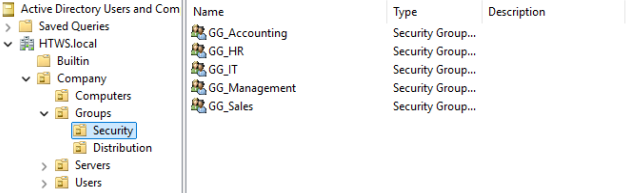
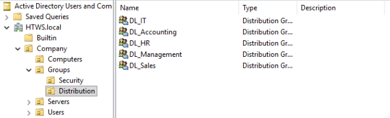
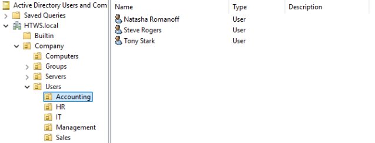
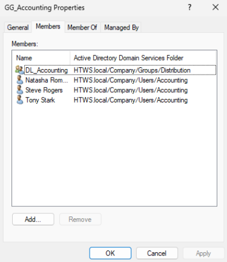

# Users and Groups

## Overview

This section documents user account and group management
within the Active Directory environment.

The objective is to simulate employee identity management
and organize users and groups within a departmental structure.

## User Accounts

Created user accounts to represent employees across
different departments within the organization.

### User Organization

| Department | Description |
|---|---|
| Accounting | Finance and accounting employees |
| HR | Human Resources employees |
| IT | Information Technology employees |
| Management | Management personnel |
| Sales | Sales department employees |

User accounts are organized into their respective
departmental OUs under the Users OU.

### Account Naming Convention

User accounts follow a consistent naming convention
to simplify identification and administration.

| Attribute | Format | Example |
|---|---|---|
| Username | First initial + last name | walterwhite |
| Display Name | Firstname Lastname | Walter White |
| Department | Department name | HR |

## Groups

Active Directory groups are used to organize users
and simplify access management.

Groups are maintained within the Groups OU.

### Security Groups

Security groups are used to assign permissions
to shared resources and other network services.

| Group | Purpose |
|---|---|
| GG_Accounting | Assign permissions to Accounting department resources |
| GG_HR | Assign permissions to HR department resources |
| GG_IT | Assign permissions to IT department resources |
| GG_Management | Assign permissions to Management resources |
| GG_Sales | Assign permissions to Sales department resources |

#### Naming Convention

- `GG` = Global Group
- Department name = Associated department

### Distribution Groups

Distribution groups are used to organize recipients
for email communication.

| Group | Purpose |
|---|---|
| DL_Accounting | Assign permissions to Accounting resources |
| DL_HR | Assign permissions to HR resources |
| DL_IT | Assign permissions to IT resources |
| DL_Management | Assign permissions to Management resources |
| DL_Sales | Assign permissions to Sales resources |

#### Naming Convention

- `DL` = Domain Local Group
- Department name = Associated department

## User Group Membership

| Username | Display Name | Department | Group Membership |
|---|---|---|---|
| natasharomanoff | Natasha Romanoff | Accounting | GG_Accounting |
| steverogers | Steve Rogers | Accounting | GG_Accounting |
| tonystark | Tony Stark | Accounting | GG_Accounting |
| hankschrader | Hank Schrader | HR | GG_HR |
| jessepinkman | Jesse Pinkman | HR | GG_HR |
| walterwhite | Walter White | HR | GG_HR |
| harrypotter | Harry Potter | IT | GG_IT |
| hermionegranger | Hermione Granger | IT | GG_IT |
| ronweasley | Ron Weasley | IT | GG_IT |
| anakinskywalker | Anakin Skywalker | Management | GG_Management |
| leiaorgana | Leia Organa | Management | GG_Management |
| lukeskywalker | Luke Skywalker | Management | GG_Management |
| dwightschrute | Dwight Schrute | Sales | GG_Sales |
| jimhalpert | Jim Halpert | Sales | GG_Sales |
| michaelscott | Michael Scott | Sales | GG_Sales |

## Group Nesting

Global Groups are added to their corresponding Domain Local Groups
to simplify resource permission management.

| Global Group | Domain Local Group |
|---|---|
| GG_Accounting | DL_Accounting |
| GG_HR | DL_HR |
| GG_IT | DL_IT |
| GG_Management | DL_Management |
| GG_Sales | DL_Sales |

## Summary

- 5 departments
- 15 user accounts
- 5 Global Security Groups
- 5 Domain Local Security Groups
- 3 users per department

## Future Improvements

- Implement role-based access control.
- Configure resource permissions.
- Automate user creation with PowerShell.
- Implement account lifecycle management.
